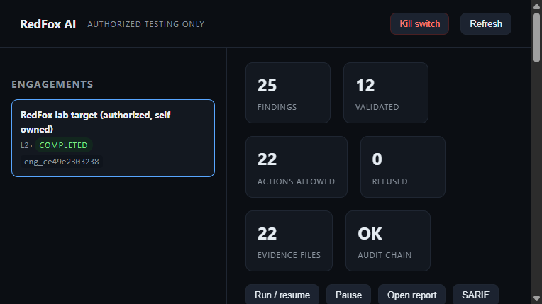

# RedFox AI

[](https://github.com/Shanmukh-l33t/RedFox-AI/actions/workflows/ci.yml)
[](LICENSE)

**An autonomous, scope-bound AI penetration-testing platform.** It takes an engagement you are authorized to test, plans the work with LLM agents, runs real security tooling through a policy gate, validates what it finds, and produces an evidence-backed report.

> ## Authorized testing only
>
> RedFox AI refuses to act on any target that is not present in an operator-attested authorization scope. You must record who you are, what authorization you hold, and exactly which hosts/URLs/ports are in scope before a single packet is sent. Unauthorized access to computer systems is illegal under the CFAA and equivalent laws worldwide.
>
> This project deliberately ships **no** mass-exploitation, worming, credential-stuffing or data-exfiltration capability. See [SECURITY.md](SECURITY.md).

---

## What it actually does

```
scope file ──► engagement record ──► policy gate ──► tool runtime ──► evidence store
                     │                                     │
                     ▼                                     ▼
              planner (LLM) ──► specialist agents ──► findings ──► SARIF / Markdown / HTML
```

- **Scope first.** An engagement cannot be created without an authorization record (operator, reference, attestation time) and an explicit allow/deny scope plus a port spec. Malformed scopes are refused at load: no wildcards, no `0.0.0.0/0`.
- **One choke point.** Adapters declare an argv; they cannot execute. `redfox/runtime.py` is the only module that spawns a process or makes a request, and it calls the policy gate immediately before acting. A test parses the AST of every other module and fails the build if that stops being true.
- **Real tools, real parsers.** nmap, nuclei, httpx, subfinder, amass, ffuf, whatweb, sslscan and an HTTP auth-check each have an adapter with a real parser. The model never reads raw tool output; it reads normalised observations.
- **Proof before report.** A finding is `validated` only when a second, policy-gated action reproduced it and the response is stored as evidence. Everything else stays `candidate` or `inconclusive` and is labelled as such.
- **Intrusive steps need a human.** The one post-exploitation step (an authenticated read of a protected page) is classified `intrusive`: it is refused below L3, files an approval request at L3, and runs only after `redfox approve`, once per operation.
- **Resumable.** Campaign state is a durable task table. Kill the process mid-run and `redfox run <id>` picks up where it stopped.
- **Credentials stay out of the record.** Write a password as `${LAB_ADMIN_PASSWORD}` and only the reference is stored; the value is read from the environment when the request is built. Credentials are never sent to a model — the validator sees `<redacted>`.

## What it does not do (v0.3.0)

- **No container isolation.** Tools run as subprocesses under your user account, behind the policy gate but not inside a sandbox. See [ARCHITECTURE.md](docs/ARCHITECTURE.md#isolation).
- **Single node.** No Redis/Celery/Postgres. The task queue is a SQLite table; multi-node execution is future work.
- **No exploitation.** The only intrusive capability is a read-only impact check: it authenticates with operator-supplied credentials and reads one page. It never writes, uploads, deletes or escalates.
- **No per-tool sandbox inside the process.** Isolation is the policy gate plus your host; run it in a container or VM for real engagements.
- **`whatweb` needs Ruby, `sslscan` needs its binary.** CI installs both on Linux; where they are absent the adapters report `NOT INSTALLED` rather than pretending.

## Quickstart

```bash
# 1. Python 3.11+ and the platform
python -m venv .venv
.venv/bin/pip install -e ".[dev]"          # Windows: .venv\Scripts\pip

# 2. Scanner binaries (nmap/subfinder/nuclei/httpx/ffuf)
./scripts/install-tools.sh                  # Windows: scripts/install-tools.ps1
nuclei -update-templates                    # one-off, ~13k templates

# 3. Start the deliberately vulnerable lab target (loopback only)
python lab/vulnapp.py --port 8080 --admin-port 8081

# 4. Create the engagement from the attested scope file
export REDFOX_LLM_PROVIDER=ollama REDFOX_LLM_MODEL=qwen2.5:3b-instruct
export REDFOX_LLM_BASE_URL=http://127.0.0.1:11434/v1
redfox init examples/scope-lab.json
# → {"engagement": "eng_…", ...}

# 5. Run it
redfox run eng_… --max-steps 20
redfox findings eng_…
redfox report eng_…
```

Reports land in `~/.redfox/reports/<engagement>/report.{sarif,md,html,pdf}`; evidence in `~/.redfox/evidence/<engagement>/`.

### Prove the scope engine refuses things

```bash
redfox scope-check eng_… https://example.com/      # exit 3, "not in the authorized scope"
redfox scope-check eng_… http://127.0.0.1:8080/ --risk intrusive   # exit 3, "exceeds autonomy"
```

### Prove an intrusive step needs a human

```bash
# L3 engagement with an "impact" spec in its config (see examples/scope-lab-l3.json)
redfox impact eng_…            # → status "awaiting_approval"; one action denied, one approval filed
redfox approvals eng_…         # → the exact tool, target and argv awaiting a decision
redfox approve apr_… --note "approved by change ticket 4421"
redfox impact eng_…
# → 2 actions allowed, finding "Authenticated access to http://…/admin/" validated,
#   approval status "consumed" (one approval authorizes one operation)
```

## Autonomy levels

Set per engagement. The ceiling is a hard cap on the risk class an adapter may declare.

| Level | Name | Allowed without a human |
|---|---|---|
| L0 | observe | passive recon only (`subfinder`) |
| L1 | scan | passive + active scanning (`nmap`, `httpx`, `ffuf`, `nuclei`, `whatweb`, `sslscan`) |
| L2 | validate | + non-destructive validation (`nuclei` template re-run, safe HTTP PoCs, auth check) |
| L3 | full-auto (lab only) | + intrusive actions, which still require an approval record unless the engagement is lab-attested **and** `auto_intrusive` is set |

Intrusive actions are never silent: the runtime files an approval request, and `redfox approve <id>` (or `POST /api/approvals/{id}`) decides it.

## Scope file

```json
{
  "name": "lab target",
  "autonomy": 2,
  "scope": {
    "allow": ["127.0.0.1", "10.10.0.0/24", "app.example.com", "https://app.example.com:8443"],
    "deny": ["admin.example.com"],
    "ports": "80,443,8080-8100"
  },
  "authorization": {
    "operator": "Your Name",
    "authorization_ref": "SOW-2026-014",
    "attested_at": "2026-11-19T00:00:00Z",
    "lab_isolated": false
  },
  "config": { "tls_verify": true }
}
```

Rules: exclusions always win; a wildcard is rejected; a CIDR must be expanded to hosts before it can be scanned (a range is not an executable target); every port an adapter requests must be inside `ports`.

## Interfaces

**CLI** — `init`, `run`, `status`, `findings`, `report`, `scope-check`, `impact`, `approvals`, `approve`, `kill`, `verify-audit`, `tools`, `serve`.

**REST + WebSocket** — `redfox serve` (loopback by default). With `REDFOX_API_TOKEN`
set, every `/api` route requires `Authorization: Bearer <token>` and `/ws/{id}`
requires `?token=`; unset, the port is loopback-only and unauthenticated:

| Method | Path | Purpose |
|---|---|---|
| GET | `/api/health` | tool availability, kill-switch state, LLM config |
| POST | `/api/engagements` | create from a scope document |
| GET | `/api/engagements/{id}` | engagement, assets, findings, recent actions, summary |
| POST | `/api/engagements/{id}/run` | start or resume |
| POST | `/api/engagements/{id}/halt` | pause |
| GET | `/api/engagements/{id}/report?fmt=html\|md\|sarif\|pdf` | report bundle |
| GET | `/api/engagements/{id}/approvals` · POST `/api/approvals/{id}` | gated actions |
| POST | `/api/kill?undo=0\|1` | global kill switch |
| GET | `/api/audit/verify` | verify the hash chain |
| WS | `/ws/{id}` | live events |

**Web UI** — served at `/`: engagement list, live event feed, findings table, report links, kill switch. If the API needs a token it asks for one inline and remembers it.



*A completed L2 campaign against the lab target: 25 findings recorded, 12 validated with evidence, 22 policy-gated actions, audit chain verified.*

## Models

Provider-agnostic; every id is configuration.

| Provider | Variables |
|---|---|
| OpenAI-compatible | `REDFOX_LLM_PROVIDER=openai`, `REDFOX_LLM_MODEL`, `REDFOX_LLM_API_KEY`, optional `REDFOX_LLM_BASE_URL` |
| Anthropic | `REDFOX_LLM_PROVIDER=anthropic`, `REDFOX_LLM_MODEL`, `REDFOX_LLM_API_KEY` |
| Local (Ollama) | `REDFOX_LLM_PROVIDER=ollama`, `REDFOX_LLM_MODEL`, `REDFOX_LLM_BASE_URL=http://127.0.0.1:11434/v1` |

Agents request JSON mode and every reply is schema-checked before it can change state. Model output can only choose *from a closed vocabulary*: a hallucinated tool, an out-of-scope target, or an invented CVE is dropped, not executed.

## Findings and evidence

Each finding carries a fingerprint, severity, CVSS (when the tool provides it), asset, location, reproduction steps and evidence ids. Each evidence id maps to a file written by the runtime containing the tool, argv, exit code, duration, output and its SHA-256. The audit log is a hash-chained JSONL file: `redfox verify-audit` recomputes the chain and reports the first break if the file was edited.

## Testing

```bash
.venv/bin/pytest -q
```

- `tests/test_safety_core.py` — scope matching, autonomy gating, kill switch, rate limits, audit tamper detection, real-tool execution.
- `tests/test_structural_guarantees.py` — no process creation outside `runtime.py`, no `shell=True`, adapters cannot reach the runtime.
- `tests/test_adapters.py` — parsers against **real captured output** in `tests/fixtures/` (an actual nmap XML, nuclei JSONL, ffuf JSON and httpx line from the lab).
- `tests/test_planning.py` — planner validation (out-of-scope and invented tools dropped), SARIF, report rendering.
- `tests/test_honesty.py` — reachability is not proof, SQLi needs a signal, triage cannot promote a discovered path.
- `tests/test_approval.py` — an intrusive action is refused, approved once, consumed, and cannot be replayed; a campaign stops at `awaiting_approval`.
- `tests/test_pdf.py` — the PDF renderer produces a structurally valid file (xref checked by offset, every finding title present).
- `tests/test_amass_adapter.py`, `tests/test_llm.py` — parser and model-client behaviour, including the empty-content retry.
- `tests/test_toolchain.py` — nmap, httpx, ffuf, nuclei and whatweb run against the live lab **through the policy gate**, so an adapter cannot quietly stop parsing.
- `tests/test_security_review.py`, `tests/test_secrets.py` — every finding in [docs/SECURITY-REVIEW.md](docs/SECURITY-REVIEW.md), including argument injection, the redacted prompt, the output cap, and a same-named binary on `PATH`.

Operational checks live in `scripts/`: `verify_evidence.py` proves every finding is
backed by an intact evidence file, and `soak.py` runs repeated campaigns and fails
on any audit break or denied action.

CI runs seven jobs on Linux and Windows for Python 3.11 and 3.12: the unit and
parser suites, the safety invariants, a **real-tool job** that installs nmap,
whatweb, sslscan, nuclei, httpx, subfinder and ffuf and runs the adapters against
the lab, and an end-to-end campaign. The campaign job needs an LLM secret; without
one it says so and the rest of the suite still gates the pull request. The
recorded run in `examples/` is the evidence that the full path works.

## Repository layout

```
redfox/
  config.py      settings and autonomy levels
  models.py      scope parsing, targets, decisions, tool calls
  policy.py      the policy enforcement point (the choke point)
  runtime.py     the only process/HTTP executor
  db.py          SQLite schema and queries
  audit.py       hash-chained audit log
  impact.py      the gated read-only post-exploitation step
  adapters/      nmap, nuclei, httpx, subfinder, amass, ffuf, whatweb, sslscan, authcheck
  agents.py      orchestrator, triage, validator, reporter
  engine.py      resumable campaign state machine
  report.py      SARIF / Markdown / HTML
  pdf.py         dependency-free PDF renderer
  api.py         FastAPI + WebSocket
  cli.py         argparse CLI
  web/           static SPA
lab/vulnapp.py   deliberately vulnerable loopback target
docs/            architecture, design synthesis, adapter guide, runbook, references
tools/           bundled wordlist; binaries are gitignored
examples/        the lab engagement, plus a recorded run's report and audit log
scripts/         tool installer, evidence verifier, soak harness
```

## Verification

[`docs/VERIFICATION.md`](docs/VERIFICATION.md) records what was actually run for
each item on the project's definition-of-done: the clean-clone campaign (26
findings, 9 validated, 19/19 evidence intact), the audit chain check, the CI jobs,
and the soak. It also lists what is still not proven.

## Design record

`docs/DESIGN_SYNTHESIS.md` contains the Phase-1 analysis of the six reference projects (pentagi, strix, ARTEX, hexstrike, Pentest-Swarm-AI, shannon): the capability matrix, what was adopted, what was rejected and why, and the deliberate stack deviations. `docs/references/` holds the per-repo analyses.

## Licence and credits

Apache-2.0. No code was copied from any reference project; see [CREDITS.md](CREDITS.md) for what was studied and what was learned from it.